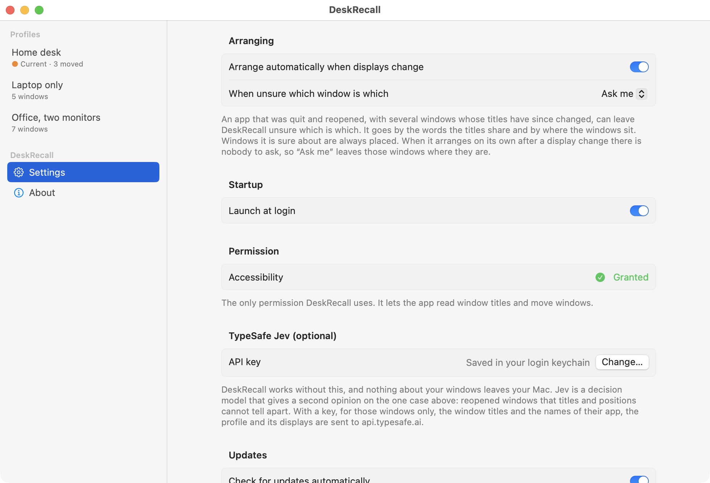
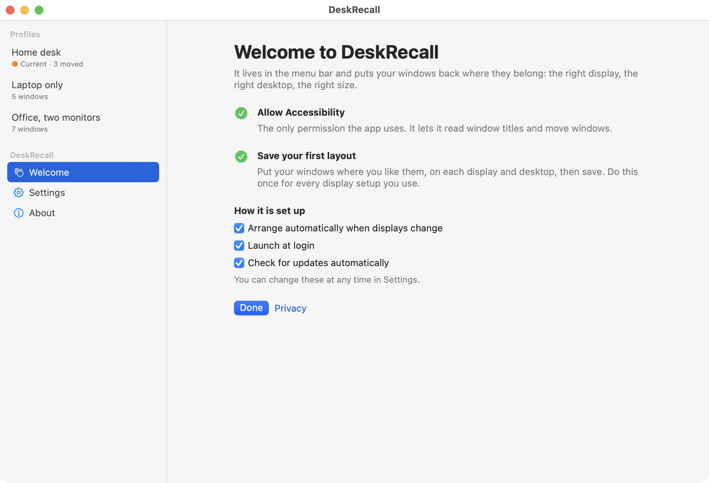

<p align="center"></p>

# DeskRecall

**Every window back where it belongs.** A macOS menu bar app that restores your window layout for
whichever displays are connected right now: the right display, the right Mission Control desktop,
the right size, minimized or not.

[Website](https://deskrecall.pragnyalabs.com) ·
[Download for macOS](https://github.com/sreenivasanac/deskrecall/releases/latest/download/DeskRecall.zip) ·
[Install notes](#install) ·
[Privacy](https://deskrecall.pragnyalabs.com/privacy.html)


## The problem

You plug your laptop into the monitor at home, then into the one at the office, then work from
the sofa. Each time, macOS leaves your windows wherever they landed: stacked on one screen, on the
wrong desktop, the chat window you keep minimized now in the middle of everything. Putting them
back by hand takes a minute, several times a day.

Window managers snap windows into halves and thirds. Layout savers put windows back on a display.
Neither brings a window back to the *desktop* (Space) it lived on, restores what was minimized, or
copes when a window's title has changed since you saved.

## What DeskRecall does

You save a **profile** once per display setup: laptop only, home monitor, office monitors.
After that, **Arrange** (or simply plugging a display in) does the rest:

- finds the profile saved for the displays connected now, or adapts the closest one to a new setup;
- works out which open window is which saved window;
- moves each one to its display, its desktop and its size, including windows on desktops you
  are not looking at;
- minimizes what was minimized, and brings back what was not.

Once a layout is applied, the menu keeps track of it: it names the layout you are on and says how
many windows have moved since. From there it is one click to put them back, or to keep the change
by updating the profile.

Apps that aren't open are skipped. Nothing is launched and nothing is closed.

## How it differs

| | Stay | Rectangle Pro | DeskRecall |
| --- | --- | --- | --- |
| Layout per display setup | yes, exact match only | yes, per named display | yes, and the closest profile is adapted to a new setup |
| Move windows to other desktops (Spaces) | no | no | yes |
| Windows on desktops you aren't looking at | no | no | yes |
| Minimized state | no | no | yes, both ways |
| See a saved layout as a picture | no | no | yes |
| Matching windows whose titles changed | manual "linking" / patterns | title regex, z-order | shared title words and position, on your Mac; a decision model (Jev) if you want one |
| Snapping, halves/thirds, shortcuts | no | yes | no (use Rectangle for that) |

Moom, BetterTouchTool, Raycast and Magnet are window managers first: very good at placing the
window in front of you with a shortcut or a drag, which DeskRecall does not do at all. Three of them
can also save a layout, and BetterTouchTool has come furthest. This is how far each goes, according to each maker's own documentation:

| | Moom 4 | BetterTouchTool | Raycast | Magnet | DeskRecall |
| --- | --- | --- | --- | --- | --- |
| Saves a whole layout | yes | yes, with a layout editor | yes, on the paid plan; up to eight windows per display | no, snapping only | yes, every open window |
| Applies it when displays change | yes | with a display trigger you build yourself | no, you run the layout | no | yes, or with one click |
| Windows on other desktops (Spaces) | no: one layout per desktop, for the desktop you are looking at | partly: since late 2026 a layout can include all desktops, by visiting each in turn and placing the windows found there; a window that ended up on another desktop is not brought back | no: a command moves the focused window one desktop over | no | yes: every window goes back to its own desktop, without switching to it, and missing desktops are added |
| Minimized windows | left out of a layout | yes, in recent versions | no (a layout can minimize what it doesn't place) | no | minimized again, or brought back out, as saved |
| Telling one app's windows apart | by app, then its own matching | its own matching | by app | n/a | the same window, file, title or browser profile, then shared title words and position |
| Two monitors of one model | by arrangement only | by name or position | not documented | n/a | by macOS's identifier and manufacture date, then position |
| Tells you the layout has drifted | no | no | no | no | yes: how many windows moved, with put back or keep |
| Snapping, grids, shortcuts, gestures | yes | yes, and much more | yes | yes | no (keep yours; DeskRecall works beside it) |

Checked in November 2026 against the [Moom help](https://manytricks.com/moom/help/customactions.html),
BetterTouchTool's release notes and its developer's forum answers
([moving between desktops](https://community.folivora.ai/t/absolute-monitor-targeting-multi-monitor-workflow-reliability/45946),
[layouts across desktops](https://community.folivora.ai/t/save-and-restore-window-layouts-across-multiple-spaces/48005)), the [Raycast manual](https://manual.raycast.com/window-management) and
the [Magnet site](https://magnet.crowdcafe.com/). These apps change; open an issue if a cell is out of date.

DeskRecall is not a window snapper. It does one thing: put a whole working layout back.

## The window

Open it from the menu (**Profiles…** or **Settings…**) or by opening the app again. The sidebar
lists your profiles, with Settings and About under them. On first launch a short Welcome guide
walks through the permission and the first profile.

**A profile** is shown as a picture: how the displays were arranged, each desktop
drawn to scale with its windows, and the minimized ones listed underneath. It is view only on
purpose. To change a layout, arrange the real windows and press **Update with Current Layout…**.
The profile you are on is marked *Current*, with the number of windows that have moved.

**Settings** holds the switches: arrange automatically when displays change, what to do with a
window the app is unsure about, launch at login, the Accessibility permission, the optional Jev key and
update checks.

**About** has the version, links, and Report a Bug, Send Feedback and Copy Diagnostics.

| Dark mode | Settings |
| --- | --- |
|  |  |



(The screenshots use made-up windows.)

## How it tells things apart

**Displays.** A monitor is identified by its vendor, model and serial number. Many monitors ship
with a placeholder serial, so two units of one model, say one at home and one at the office, look
identical on those three. DeskRecall therefore also records the week and year the monitor was made
and the persistent identifier macOS itself gives it:

- A different manufacture date means a different unit, so the office monitor does not pick up the
  home profile.
- When several profiles fit, the one whose monitors macOS recognises and whose arrangement matches
  wins; if that is still a tie, the profile you last used there.
- Two identical monitors side by side keep their own windows: they are told apart by macOS's
  identifier, then by position.
- A monitor counts as the same monitor at any scaled resolution, because frames are stored as
  fractions of the display.

**Windows.** For each window a profile records the app, the title, the file it shows (for apps that
report one), its window id, and its display, desktop, frame and minimized state. When arranging,
the surest evidence is used first:

1. The window id, for as long as the window has stayed open since the save. Unplugging and
   replugging a monitor never closes windows, so in the everyday case every window is recognised
   exactly, whatever its title says now.
2. The same file.
3. The same title.
4. One open window and one saved window left for an app: they belong together.
5. Anything still open is scored by title and position (below).

Windows of a Chromium browser are matched only within their own browser profile, which Chrome and
Comet put at the end of the window title. A Work window never takes a
Personal window's place.

## How it decides the unclear cases

Everything is decided on your Mac, by rules you can read in `Arranger.swift`:

- **Which profile?** When no profile was saved on this set of monitors, the one whose displays are
  most like these: the same units, then the same models, then the same kind (built-in or external)
  and resolution. It is used without asking only when it stands alone and the setup has the same
  shape, the same number of built-in and external displays.
- **Which display stands in for which?** The same scoring, display by display. With fewer displays
  than the profile had, the ones that are gone share the most alike of those left.
- **Which window is which?** When an app was quit and reopened, has several windows, and their
  titles have changed, nothing identifies them for certain. Two signs are then weighed: the words
  the old and new titles share (leaving out the ones every window of the app has, such as the app's
  name), and whether a window already sits where a saved one was, as it does when macOS reopens an
  app's windows. A pairing counts as sure only when it stands clear of every other.

A pairing that is not sure is a conflict, and **Settings → When unsure which window is
which** says what happens: *Ask me* (one dialog with the best guess preselected), *Use the best
guess*, or *Leave the window where it is*. When DeskRecall arranges on its own after a display
change there is nobody to ask, so *Ask me* leaves those windows alone. Auto-arrange never picks a
profile by guesswork either: with no clear match it does nothing.

### Optional: a decision model for the last case

Shared words are not meaning: a window now titled "Pull request #42" and one saved as "GitHub" have
nothing in common for the rules. If you add a [TypeSafe Jev](https://typesafe.ai) key under
Settings, the windows the rules are unsure about, and only those, are put to Jev, a decision model
that returns a typed answer with a calibrated confidence. For that the window titles and the names
of their app, the profile and its displays are sent to `api.typesafe.ai`. Without a key nothing
about your windows leaves your Mac. The [privacy page](https://deskrecall.pragnyalabs.com/privacy.html)
lists everything the app stores and sends.

## Install

### Download

1. Download [DeskRecall.zip](https://github.com/sreenivasanac/deskrecall/releases/latest/download/DeskRecall.zip),
   unzip it and move **DeskRecall** to your Applications folder.
2. Open it. The app is signed with a Developer ID and notarized by Apple, so macOS opens it
   after the usual "downloaded from the internet" confirmation.
3. Grant **Accessibility** when asked (System Settings → Privacy & Security → Accessibility). It is
   the only permission the app uses; it is what lets it read window titles and move windows.
4. Lay out your windows, then choose **Save Layout as New Profile…** from the menu bar icon.
   Repeat once per display setup.
5. Optional: add a TypeSafe Jev key under **Settings** for a second opinion on reopened windows.

### Requirements and compatibility

| | |
| --- | --- |
| macOS | 14 (Sonoma) or later. Moving windows between desktops needs macOS 26.4 or later; on older versions displays, positions, sizes and minimized state are still restored. |
| Mac | Apple Silicon or Intel (universal app). Tested on Apple Silicon with macOS 26.7; Intel is untested. |
| Permission | Accessibility only. |
| Network | A daily check for a new version (can be switched off). Nothing else, unless you add a Jev key. |
| Distribution | Outside the Mac App Store only: desktops are handled through a private macOS framework. |

### Build from source

Needs the Xcode command line tools.

```bash
git clone https://github.com/sreenivasanac/deskrecall.git
cd deskrecall
scripts/build-app.sh
```

This builds `DeskRecall.app`, signs it, installs it to `/Applications` and launches it. The script
uses a Developer ID certificate if your keychain has one, else the first code-signing identity, so
the Accessibility grant survives rebuilds; with none, it signs ad hoc and macOS asks again after
each rebuild. `RELEASE=1` also notarizes and staples when a Developer ID certificate is present.

## Menu

- **Layout: “…”** — the layout these displays are on, and whether any of its windows has moved since, and how many.
- **Restore “…”** — put the windows back where that layout has them. Reads **Put Windows Back**
  once something has moved. With no profile for the connected displays it reads **Arrange from the
  Closest Profile**.
- **Update “…” with Current Layout…** — keep the change instead (asks first; there is no undo).
  Reads **Keep This Layout** once something has moved.
- **Save Layout as New Profile…** — saving under an existing name updates that profile.
- **Switch to Profile ▸** — arrange from another profile. A tick marks the layout in force, a dash
  the same layout after windows have moved.
- **Profiles…** / **Settings…** — the window.
- **Auto-arrange When Displays Change** — arranges a few seconds after a monitor is connected or
  removed. Also in Settings; it is in the menu for the moment before you plug into a projector.
- **Help ▸** — the Welcome guide, the website, **Report a Bug…** (a GitHub issue, filled in),
  **Send Feedback…** (an email) and **Copy Diagnostics**. Diagnostics hold versions, displays,
  counts and settings, never window titles or names. Report a Bug passes them to GitHub when it
  opens the issue page; Copy Diagnostics sends nothing.
- **Check for Updates…** — the app also checks about once a day and offers to install a new version.

## Command line

Accessibility belongs to the app bundle, so run commands through it:

```bash
open -W -n -a DeskRecall --args --arrange --out /tmp/deskrecall.txt
```

`--arrange [--profile NAME]`, `--save NAME`, `--moved NAME` (how many of a profile's windows are out of
place), `--dump [--verbose]` (displays, desktops and windows as
the app sees them), `--selfcheck` (logic tests; runs straight from `.build/debug/DeskRecall`).

For checking what a macOS release still allows, one step on one window (ids from `--dump`):
`--move WINDOW SPACE`, `--minimize WINDOW true|false`, `--frame WINDOW X Y WIDTH HEIGHT`,
`--add-desktop DISPLAY`, `--remove-desktop DISPLAY`. `--save NAME --app BUNDLEID` saves only one app's windows. For screenshots: `--shot FILE.png [--pane Settings]`
renders the window to an image without showing it, `--show Profiles|Settings [--light]` opens the real one.

The Jev key can also come from a `TYPESAFE_API_KEY` environment variable, which wins over the
keychain. To put a key in the keychain without the window, let the app store it (an item added by
another tool, such as `security`, makes macOS prompt on every read):

```bash
open -W -n --env TYPESAFE_API_KEY=your-key -a DeskRecall --args --store-key
```

## Tests

`--selfcheck` covers the pure logic. The live tests drive the installed app against real windows:

```bash
uv run python scripts/live-test.py              # every case the connected displays allow
uv run python scripts/live-test.py frame dock   # only the named cases
```

They open three TextEdit windows, save a layout, disturb it, check the app reports the change, run Arrange and check that every window
is back. Cases: `frame` (moved and resized), `restore` (minimized now, on screen in the profile),
`dock` (minimized in the profile), `desktop` (wrong desktop, including one not showing),
`desktop-dock` (minimized and on the wrong desktop), `display` (wrong display), `new-desktop` (the
profile's desktop no longer exists and is added), `reopened` (closed and opened again, so the window
ids changed). Cases that need a second desktop or display are skipped without one, so run the tests
once on each setup you use. Your profiles and settings are put back afterwards; TextEdit must be
closed before you start.

## Limits

- Desktops (Spaces) are handled through Apple's private SkyLight framework because no public API
  exists. That rules out the Mac App Store, and a future macOS could break it; the app then still
  restores displays, positions and sizes.
- Desktops are remembered by position ("third desktop on the built-in display"). If a profile needs
  more desktops than a display has, DeskRecall adds them by opening Mission Control and pressing its
  "+" button for you, so Mission Control shows for about a second. If that fails it uses the last
  desktop and tells you.
- Two monitors of one model with the same serial, the same manufacture date, the same macOS
  identifier and the same arrangement cannot be told apart. The profile last used wins; switch with
  **Switch to Profile ▸**.
- The browser-profile rule covers Chromium browsers. Safari, Firefox and Edge name profiles
  differently or not at all; their windows fall through to title matching.
- The Jev key lives in your login keychain. If you used a version before 0.4, macOS asks for your
  keychain password once, the first time the key is needed, because the app's signature changed;
  it also asks you to grant Accessibility again.
- Versions before 0.5 have no updater. If you installed one, download 0.5 once by hand; later
  versions arrive through **Check for Updates…**.
- With "Displays have separate Spaces" switched off in System Settings, one row of desktops spans
  every display. The code handles that case but it has not been tested on a real Mac.
- Full-screen windows are left alone. So are windows that are open but not in the profile.
- A profile saved by an earlier version has no minimized state (0.1) or window ids (0.2). Press
  **Update with Current Layout…** once to record them.
- If the profiles file can't be read (hand-edited, or written by a newer version) it is moved aside
  to `profiles.unreadable.json` rather than overwritten.
- Profiles live in `~/Library/Application Support/DeskRecall/profiles.json`.

## Layout of the code

`Sources/DeskRecall/` — `Config` (names, thresholds, settings keys), `Displays` (identity and
pairing), `Spaces` (private API), `Windows` (Accessibility), `Profiles` (saved layouts and how well
one fits the displays), `Jev`, `Arranger` (pick the profile, match, move), `App` (menu and actions),
`Dialogs` (alerts), `ProfilesWindow`, `SettingsView` and `Panes` (the SwiftUI window: profiles, settings, Welcome and
About), `Updates` (Sparkle, the one dependency), `Diagnostics` (bug reports and feedback).

`scripts/build-app.sh` builds, signs and installs (`RELEASE=1` writes the notarized release archive
and the update feed `site/appcast.xml` instead);
`scripts/make-icon.swift` draws the icon; `site/` is the website at
[deskrecall.pragnyalabs.com](https://deskrecall.pragnyalabs.com).

## Licence

[MIT](LICENSE). The software comes with no warranty; see the
[terms](https://deskrecall.pragnyalabs.com/terms.html).
