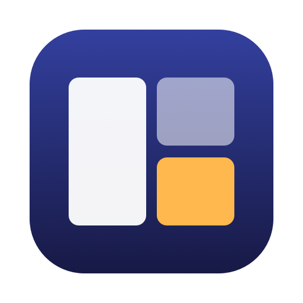
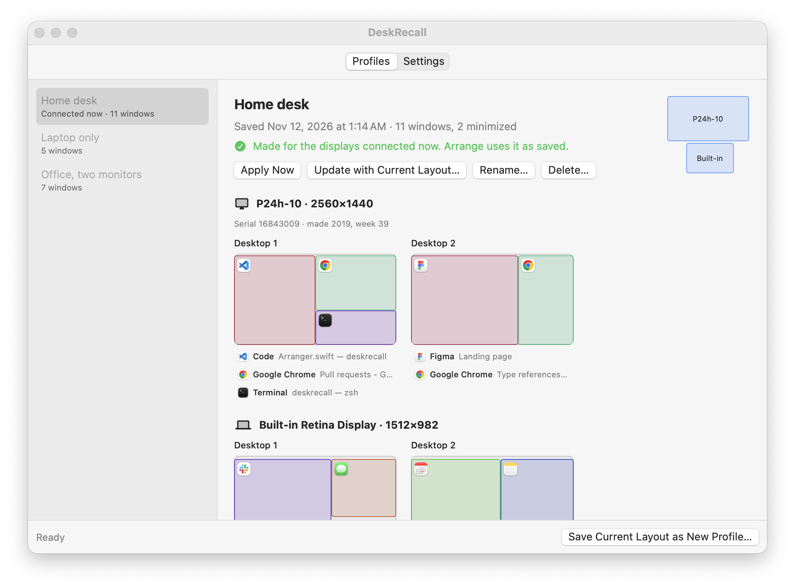
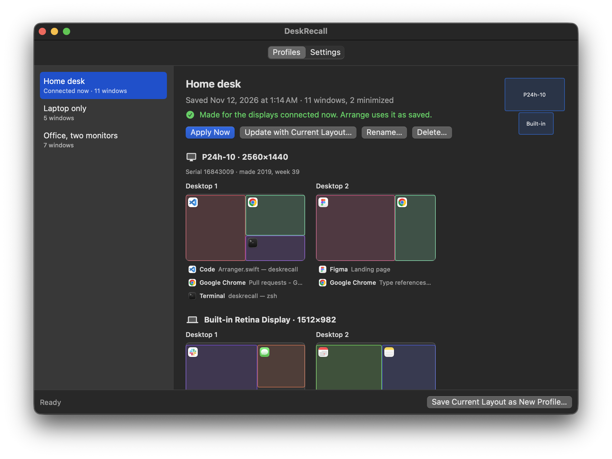

<p align="center"></p>

# DeskRecall

**Every window back where it belongs.** A macOS menu bar app that restores your window layout for
whichever displays are connected right now: the right display, the right Mission Control desktop,
the right size, minimized or not.

[Website](https://deskrecall.pragnyalabs.com) ·
[Download for macOS](https://github.com/sreenivasanac/deskrecall/releases/latest/download/DeskRecall.zip) ·
[Install notes](#install)



## The problem

You plug your laptop into the monitor at home, then into the one at the office, then work from
the sofa. Each time, macOS leaves your windows wherever they landed: stacked on one screen, on the
wrong desktop, the chat window you keep minimized now in the middle of everything. Putting them
back by hand takes a minute, several times a day.

Window managers snap windows into halves and thirds. Layout savers put windows back on a display.
Neither brings a window back to the *desktop* (Space) it lived on, restores what was minimized, or
copes when a window's title has changed since you saved.

## What DeskRecall does

You save a **profile** once per display setup: laptop only, home monitor, office monitors.
After that, **Arrange** (or simply plugging a display in) does the rest:

- finds the profile saved for the displays connected now, or adapts the closest one to a new setup;
- works out which open window is which saved window;
- moves each one to its display, its desktop and its size, including windows on desktops you
  are not looking at;
- minimizes what was minimized, and brings back what was not.

Apps that aren't open are skipped. Nothing is launched and nothing is closed.

## How it differs

| | Stay | Rectangle Pro | DeskRecall |
| --- | --- | --- | --- |
| Layout per display setup | yes, exact match only | yes, per named display | yes, and the closest profile is adapted to a new setup |
| Move windows to other desktops (Spaces) | no | no | yes |
| Windows on desktops you aren't looking at | no | no | yes |
| Minimized state | no | no | yes, both ways |
| See a saved layout as a picture | no | no | yes |
| Matching windows whose titles changed | manual "linking" / patterns | title regex, z-order | a decision model (Jev) |
| Snapping, halves/thirds, shortcuts | no | yes | no (use Rectangle for that) |

DeskRecall is not a window snapper. It does one thing: put a whole working layout back.

## The window

Open it from the menu (**Profiles…** or **Settings…**) or by opening the app again.

**Profiles** shows every saved layout as a picture: how the displays were arranged, each desktop
drawn to scale with its windows, and the minimized ones listed underneath. It is view only on
purpose. To change a layout, arrange the real windows and press **Update with Current Layout…**.

**Settings** holds the switches: arrange automatically when displays change, what to do with a
window the app is unsure about, launch at login, the Accessibility permission and the Jev key.

| Dark mode | Settings |
| --- | --- |
|  |  |

(The screenshots use made-up windows.)

## How it tells things apart

**Displays.** A monitor is identified by its vendor, model and serial number. Many monitors ship
with a placeholder serial, so two units of one model, say one at home and one at the office, look
identical on those three. DeskRecall therefore also records the week and year the monitor was made
and the persistent identifier macOS itself gives it:

- A different manufacture date means a different unit, so the office monitor does not pick up the
  home profile.
- When several profiles fit, the one whose monitors macOS recognises and whose arrangement matches
  wins; if that is still a tie, the profile you last used there.
- Two identical monitors side by side keep their own windows: they are told apart by macOS's
  identifier, then by position.
- A monitor counts as the same monitor at any scaled resolution, because frames are stored as
  fractions of the display.

**Windows.** For each window a profile records the app, the title, the file it shows (for apps that
report one), its window id, and its display, desktop, frame and minimized state. When arranging,
the surest evidence is used first:

1. The window id, for as long as the window has stayed open since the save. Unplugging and
   replugging a monitor never closes windows, so in the everyday case every window is recognised
   exactly, whatever its title says now.
2. The same file.
3. The same title.
4. One open window and one saved window left for an app: they belong together.
5. Anything still open goes to Jev (below).

Windows of a Chromium browser (Chrome, Comet, Brave…) are matched only within their own browser
profile, which those browsers put at the end of the window title. A Work window never takes a
Personal window's place.

## How it decides the unclear cases

Every judgement call goes to [TypeSafe Jev](https://typesafe.ai), a decision model that returns a
typed answer with a calibrated confidence:

- **Which profile?** When no profile was saved on this set of monitors.
- **Which display stands in for which?** When a profile is replayed on different monitors.
- **Which window is which?** When an app has several windows and nothing above settles it.

For those questions the names of your displays and the titles of the windows in question are sent
to `api.typesafe.ai`. Nothing else is sent, and nothing at all without a key.

A low-confidence answer about a window is a conflict, and **Settings → When unsure which window is
which** says what happens: *Ask me* (one dialog with the best guess preselected), *Use the best
guess*, or *Leave the window where it is*. When DeskRecall arranges on its own after a display
change there is nobody to ask, so *Ask me* leaves those windows alone. Auto-arrange never picks a
profile by guesswork either: with no clear match it does nothing.

Without a Jev key the app still works for exact setups; same-app windows that the rules above
can't settle are paired in window order, and you pick the profile yourself when it is ambiguous.

## Install

### Download

1. Download [DeskRecall.zip](https://github.com/sreenivasanac/deskrecall/releases/latest/download/DeskRecall.zip),
   unzip it and move **DeskRecall** to your Applications folder.
2. Open it. The app is not notarized by Apple, so macOS blocks the first launch: open
   **System Settings → Privacy & Security**, scroll to *Security* and click **Open Anyway**.
   (Or run `xattr -dr com.apple.quarantine /Applications/DeskRecall.app` once.)
3. Grant **Accessibility** when asked (System Settings → Privacy & Security → Accessibility). It is
   the only permission the app uses; it is what lets it read window titles and move windows.
4. Lay out your windows, then choose **Save Layout as New Profile…** from the menu bar icon.
   Repeat once per display setup.
5. Optional: add a TypeSafe Jev key under **Settings** for the unclear cases.

### Requirements and compatibility

| | |
| --- | --- |
| macOS | 14 (Sonoma) or later. Moving windows between desktops needs macOS 26.4 or later; on older versions displays, positions, sizes and minimized state are still restored. |
| Mac | Apple Silicon or Intel (universal app). Tested on Apple Silicon with macOS 26.7; Intel is untested. |
| Permission | Accessibility only. |
| Network | None, unless you add a Jev key. |
| Distribution | Outside the Mac App Store only: desktops are handled through a private macOS framework. |

### Build from source

Needs the Xcode command line tools.

```bash
git clone https://github.com/sreenivasanac/deskrecall.git
cd deskrecall
scripts/build-app.sh
```

This builds `DeskRecall.app`, signs it, installs it to `/Applications` and launches it. The script
uses the first code-signing identity in your keychain so the Accessibility grant survives rebuilds;
with none, it signs ad hoc and macOS asks again after each rebuild.

## Menu

- **Arrange** — find the profile for the current displays and arrange.
- **Apply Profile ▸** — arrange from a specific profile (ticked: saved on the displays connected now).
- **Save Layout as New Profile…** / **Update “…” with Current Layout…** (asks first; there is no undo).
  Saving under an existing name updates that profile.
- **Profiles…** / **Settings…** — the window.
- **Auto-arrange When Displays Change** — arranges a few seconds after a monitor is connected or
  removed. Also in Settings; it is in the menu for the moment before you plug into a projector.

## Command line

Accessibility belongs to the app bundle, so run commands through it:

```bash
open -W -n -a DeskRecall --args --arrange --out /tmp/deskrecall.txt
```

`--arrange [--profile NAME]`, `--save NAME`, `--dump [--verbose]` (displays, desktops and windows as
the app sees them), `--selfcheck` (logic tests; runs straight from `.build/debug/DeskRecall`).

For checking what a macOS release still allows, one step on one window (ids from `--dump`):
`--move WINDOW SPACE`, `--minimize WINDOW true|false`. For screenshots: `--shot FILE.png [--pane Settings]`
renders the window to an image without showing it, `--show Profiles|Settings [--light]` opens the real one.

The Jev key can also come from a `TYPESAFE_API_KEY` environment variable, which wins over the
keychain. To put a key in the keychain without the window, let the app store it (an item added by
another tool, such as `security`, makes macOS prompt on every read):

```bash
open -W -n --env TYPESAFE_API_KEY=your-key -a DeskRecall --args --store-key
```

## Limits

- Desktops (Spaces) are handled through Apple's private SkyLight framework because no public API
  exists. That rules out the Mac App Store, and a future macOS could break it; the app then still
  restores displays, positions and sizes.
- Desktops are remembered by position ("third desktop on the built-in display"). DeskRecall doesn't
  create desktops: if a profile needs more than exist, it uses the last one and tells you.
- Two monitors of one model with the same serial, the same manufacture date, the same macOS
  identifier and the same arrangement cannot be told apart. The profile last used wins; switch with
  **Apply Profile ▸**.
- The browser-profile rule covers Chromium browsers. Safari, Firefox and Edge name profiles
  differently or not at all; their windows fall through to title matching and Jev.
- The Jev key lives in your login keychain. Because the app is not notarized, macOS may ask for
  your keychain password once after you install a new version, the first time the key is needed.
- With "Displays have separate Spaces" switched off in System Settings, one row of desktops spans
  every display. The code handles that case but it has not been tested on a real Mac.
- Full-screen windows are left alone. So are windows that are open but not in the profile.
- A profile saved by an earlier version has no minimized state (0.1) or window ids (0.2). Press
  **Update with Current Layout…** once to record them.
- If the profiles file can't be read (hand-edited, or written by a newer version) it is moved aside
  to `profiles.unreadable.json` rather than overwritten.
- Profiles live in `~/Library/Application Support/DeskRecall/profiles.json`.

## Layout of the code

`Sources/DeskRecall/` — `Config` (names, thresholds, settings keys), `Displays` (identity and
pairing), `Spaces` (private API), `Windows` (Accessibility), `Profiles` (saved layouts and how well
one fits the displays), `Jev`, `Arranger` (pick the profile, match, move), `App` (menu and actions),
`Dialogs` (alerts), `ProfilesWindow` and `SettingsView` (the SwiftUI window).

`scripts/build-app.sh` builds, signs and installs (`RELEASE=1` writes the release archive instead);
`scripts/make-icon.swift` draws the icon; `site/` is the website at
[deskrecall.pragnyalabs.com](https://deskrecall.pragnyalabs.com).
